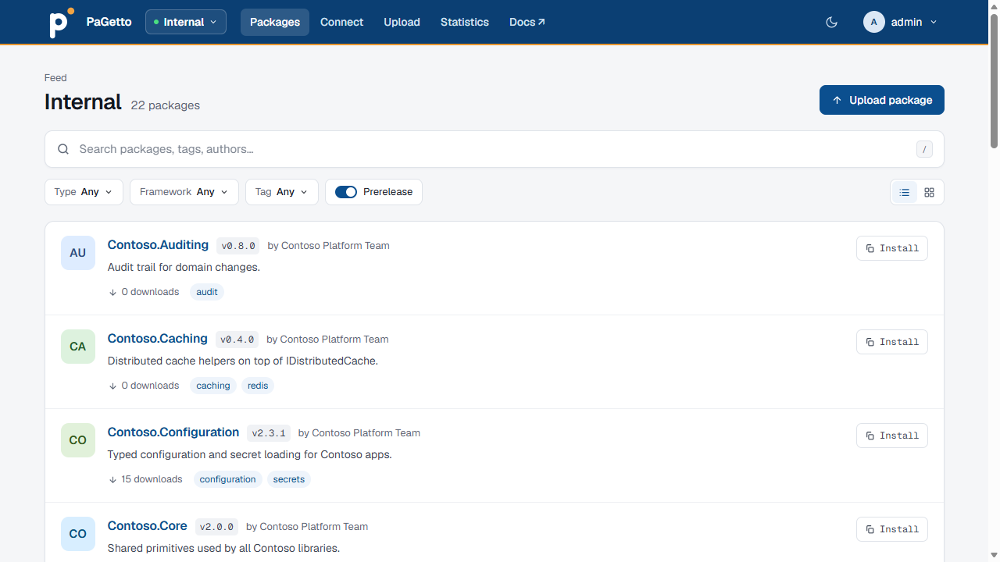

# PaGetto

PaGetto (pronounced "pa getto") is a lightweight, self-hosted **package server**. One server hosts the packages of many ecosystems, from NuGet and npm to Maven, Python, Rust and Go, each in its own [feeds](feeds.md), and every feed can cache the public registry of its ecosystem. The standard clients (`dotnet`, `npm`, `mvn`, `pip`, `cargo`, `go` and the others) work with it as they do with the public registries. PaGetto is [open source](https://github.com/letreset/PaGetto), cross-platform and cloud ready.

## Package formats

Each feed has a type, chosen when the feed is created. A feed of a type speaks that ecosystem's protocol, so its clients need nothing more than the feed's URL and a token.

| Feed type | Clients | Mirror of |
|---|---|---|
| [NuGet](nuget.md) (with symbols) | dotnet CLI, NuGet CLI, Visual Studio, Rider, Paket | nuget.org, NuGet v3 and v2 feeds |
| [Dart](dart.md) | `dart pub`, `flutter pub` | pub.dev |
| [npm](npm.md) | npm, Yarn, pnpm | registry.npmjs.org |
| [Maven](maven.md) | Maven, Gradle, sbt | Maven Central |
| [Python](pypi.md) | pip, uv, Poetry, twine | PyPI |
| [Rust](cargo.md) | Cargo | crates.io |
| [Go](go.md) | the go command (GOPROXY) | proxy.golang.org |
| [Ruby](rubygems.md) | Bundler, `gem` | rubygems.org |
| [Hex](hex.md) | Mix, Rebar3 | hex.pm |
| [PHP](composer.md) | Composer | Packagist |
| [CocoaPods](cocoapods.md) | `pod` | cdn.cocoapods.org |
| [Swift](swift.md) | Swift Package Manager, Xcode | other Swift package registries |
| [R](cran.md) | `install.packages`, renv | CRAN |
| [Ivy](ivy.md) | sbt (Ivy layout) | the sbt plugin repository |
| [VSIX](vsix.md) | Visual Studio (private extension gallery) | other extension galleries |
| [VS Code](vscode.md) | VSCodium, code-server, Code - OSS (extension gallery API) | Open VSX |

## Features

PaGetto offers:

- **[Multiple feeds](feeds.md)**: each feed has its own packages, settings, retention, permissions and read-through [mirrors](feeds.md#mirror-read-through-cache) of one or more upstream registries, and can call a [webhook](feeds.md#webhook) on every package change.
- **[Users and permissions](authentication.md)**: local accounts, LDAP and Active Directory users, single sign-on through Microsoft Entra ID, OpenID Connect or SAML, groups, per-feed pull/push/delete permissions, and personal access tokens (also limited to reading or to one feed) with expiry email reminders.
- **A [web UI](web-ui.md)** to browse every feed's packages, with readmes, install commands per client, unlisting and deletion, statistics and admin pages for feeds, accounts and groups.
- **Operations**: an [audit log](configuration.md#audit-log), retention per feed, health checks, OpenTelemetry metrics, Data Protection keys in storage (sign-in cookies survive restarts and work across replicas), security headers, CORS and rate limiting.

Coming from BaGetter? PaGetto takes over an existing BaGetter database and package storage in place; see [Migrating from BaGetter](migrating-from-bagetter.md).

## Backends

| | Supported |
|---|---|
| Database | SQLite, SQL Server, PostgreSQL, MySQL |
| Package storage | File system, Azure Blob Storage, AWS S3, Google Cloud Storage, Alibaba Cloud (Aliyun) OSS, Tencent Cloud COS |
| Hosting | Docker (`linux/amd64`, `linux/arm64`), Kubernetes (Helm), Windows/IIS, any machine with the ASP.NET Core 10 runtime |

## Run PaGetto

- [Docker](Installation/docker.md)
- [Kubernetes (Helm)](Installation/kubernetes.md)
- [On your computer](Installation/local.md)
- [Azure](Installation/azure.md), [AWS](Installation/aws.md), [Google Cloud](Installation/gcp.md), [Alibaba Cloud](Installation/aliyun.md), [Tencent Cloud](Installation/tencent.md)
- [Behind Windows IIS](Installation/iis-proxy.md)

Then [create a feed](feeds.md#managing-feeds) for each ecosystem you use and follow its page above to connect the clients.
