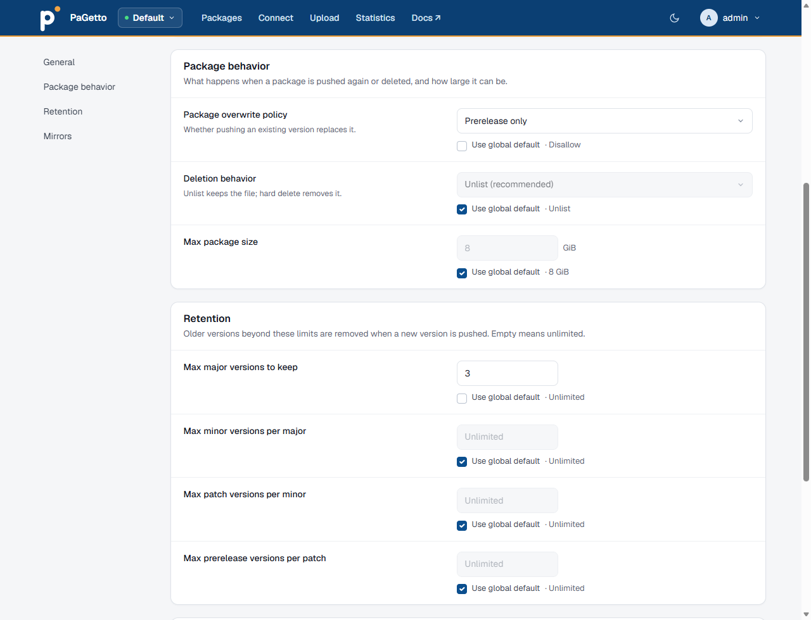
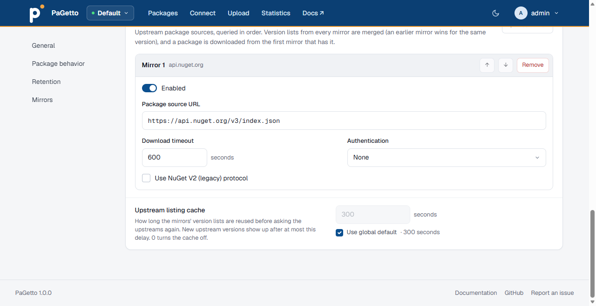

# Feeds

A **feed** is a separate package source inside one PaGetto server. Each feed has its own packages, its own settings (overwrites, deletion, retention, size limit, read-only mode), its own read-through mirrors and its own permissions. Use feeds to keep, for example, `internal` packages apart from `experimental` ones, to give each team a mirror of a public registry with different rules, or to host the packages of several ecosystems on one server.

## Feed types

Every feed has a **type**, the kind of packages it serves, and speaks that ecosystem's protocol. This page describes what all feeds share; the page of each type covers its clients, publishing and mirrors:

| Type | Page | Client URL of a feed with the slug `{slug}` |
|---|---|---|
| NuGet | [NuGet packages](nuget.md) | `https://your-server/feeds/{slug}/v3/index.json` |
| Dart | [Dart and Flutter packages](dart.md) | `https://your-server/feeds/{slug}` |
| npm | [npm packages](npm.md) | `https://your-server/feeds/{slug}/npm/` |
| Maven | [Maven packages](maven.md) | `https://your-server/feeds/{slug}/maven2/` |
| Python | [Python packages](pypi.md) | `https://your-server/feeds/{slug}/pypi/simple/` |
| Rust | [Rust crates](cargo.md) | `sparse+https://your-server/feeds/{slug}/cargo/index/` |
| Go | [Go modules](go.md) | `https://your-server/feeds/{slug}/go` |
| Ruby | [Ruby gems](rubygems.md) | `https://your-server/feeds/{slug}/rubygems/` |
| Hex | [Hex packages](hex.md) | `https://your-server/feeds/{slug}/hex` |
| PHP | [PHP packages](composer.md) | `https://your-server/feeds/{slug}/composer` |
| CocoaPods | [CocoaPods pods](cocoapods.md) | `https://your-server/feeds/{slug}/cocoapods/` |
| Swift | [Swift packages](swift.md) | `https://your-server/feeds/{slug}/swift` |
| R | [R packages](cran.md) | `https://your-server/feeds/{slug}/cran` |
| Ivy | [Ivy repositories for sbt](ivy.md) | `https://your-server/feeds/{slug}/ivy` |
| VSIX | [Visual Studio extensions](vsix.md) | `https://your-server/feeds/{slug}/vsix/atom.xml` |

## Feed URLs

Every feed has a **slug**, and everything of the feed lives under `/feeds/{slug}/`: the client API in the table above and the web UI, e.g. `https://your-server/feeds/internal/` lists that feed's packages.

The **default feed** (slug `default`) is created on first start, is always a NuGet feed and can't be deleted. Its URLs also work without the prefix (`https://your-server/v3/index.json`), the ones PaGetto has always used, so NuGet clients configured before multi-feed support keep working. Feeds of the other types are always reached through `/feeds/{slug}/`.

## Managing feeds

Feeds are managed by administrators on **Admin > Feeds**. This needs `Authentication:Mode` set to `Local`, `Entra` or `Hybrid` (see [Authentication](authentication.md)). The `Legacy` mode has no administrators, so only the default feed exists.

- **Create** a feed with **New feed**: a slug, a type, a display name (at most 256 characters) and an optional description (at most 4000 characters). A slug is lowercase letters, digits and hyphens, can't start or end with a hyphen, and is at most 128 characters. It becomes part of the URL, so choose it with care. The type (NuGet, [Dart](dart.md), [npm](npm.md), [Maven](maven.md), [Python](pypi.md), [Rust](cargo.md), [Go](go.md), [Ruby](rubygems.md), [Hex](hex.md), [PHP](composer.md), [CocoaPods](cocoapods.md), [Swift](swift.md), [R](cran.md), [Ivy](ivy.md) or [VSIX](vsix.md)) can't be changed afterwards either.
- **Reorder** feeds by dragging them. The order is used wherever feeds are listed in the UI.
- Open a feed's **Settings** to change its display name, description and [settings](#feed-settings).
- **Delete** a feed with its trash button. This deletes all of its packages from the database and storage. It can't be undone.

There is also a small JSON API at `/api/v1/feeds`. It only accepts the web UI's sign-in cookie, so it is meant for administrators signed in to the web UI; personal access tokens and Basic auth don't work there.

| Request | Effect |
|---|---|
| `GET /api/v1/feeds`, `GET /api/v1/feeds/{slug}` | List all feeds, or get one |
| `POST /api/v1/feeds` | Create a feed from `slug`, `name`, `description` and `type` (`"NuGet"`, the default, `"Pub"` for a Dart feed, `"Npm"` for an npm feed, `"Maven"` for a Maven feed, `"PyPI"` for a Python feed, `"Cargo"` for a Rust feed, `"Go"` for a Go feed, `"RubyGems"` for a Ruby feed, `"Hex"` for a Hex feed, `"Composer"` for a PHP feed, `"CocoaPods"` for a CocoaPods feed, `"Swift"` for a Swift feed, `"Cran"` for an R feed, `"Ivy"` for an Ivy feed or `"Vsix"` for a VSIX feed) |
| `PUT /api/v1/feeds/{slug}` | Change only the `name` and `description` |
| `DELETE /api/v1/feeds/{slug}` | Delete the feed and its packages. The default feed returns `409 Conflict` |

Settings, mirrors and the feed order can only be changed in the web UI. Changes made through the API are not written to the [audit log](configuration.md#audit-log).

## Feed settings

Open **Admin > Feeds > Settings** for a feed (`/Admin/Feeds/{slug}/Settings`). Each setting has a **Use global default** checkbox: while it is checked, the feed follows the value from [configuration](configuration.md); uncheck it to override the value for this feed only.



| Setting | Global setting | Description |
|---|---|---|
| Read-only mode | `IsReadOnlyMode` | Reject publishing, unlisting, deleting and relisting on this feed, from clients and from the web UI |
| Package overwrite policy | `AllowPackageOverwrites` | Disallow (recommended), prerelease only, or allow all. See [package overwrites](configuration.md#enable-package-overwrites). |
| Deletion behavior (NuGet feeds) | `PackageDeletionBehavior` | Unlist (recommended) or hard delete. See [hard deletions](configuration.md#enable-package-hard-deletions). |
| Max package size (MiB) | `MaxPackageSizeMiB` | Largest package or symbol package this feed accepts, at least 1 MiB. It can only lower the global value, which caps every request; larger pushes get `413 Payload Too Large` |
| Retention | `Retention` (NuGet feeds) | How many major versions, minor versions per major, patch versions per minor and prerelease versions per patch to keep, each 0 or more. `0` keeps none of them except the version being pushed. On a NuGet feed an override left empty falls back to the global value; other feeds have no global value and apply their limits within an hour. **Prereleases of older majors** deletes prereleases below the latest stable major (`DeletePrereleasesOfOlderMajors`). See [auto-deletion](configuration.md#package-auto-deletion). |
| Upstream listing cache (seconds) | `UpstreamListingCacheSeconds` | How long mirrored version lists are reused before asking the upstreams again. See [upstream listing cache](#upstream-listing-cache). |
| Block malicious packages | `BlockMaliciousPackages` | Whether versions that the malicious packages data lists are refused from the feed's mirrors. Only shown for feed types the data covers. See [Malicious packages](malicious-packages.md). |
| Quarantine vulnerable versions | `QuarantineSeverity` | Hold back versions with a known vulnerability of this severity or higher, and new versions until their first scan. See [Quarantine](quarantine.md). |
| Quarantine malicious packages | `QuarantineMaliciousPackages` | Hold back new versions that the malicious packages data lists, published ones too. See [Quarantine](quarantine.md). |
| Unused mirrored versions (days) | `MirrorCacheRetentionDays` | After how many days without a download a version stored from a mirror is removed; it is mirrored again when next requested. `0` keeps them. See [unused mirrored packages](configuration.md#unused-mirrored-packages). |

:::tip

Set the values you want for most feeds in configuration, and override only where a feed differs. Changing a global value then updates every feed that still uses the default.

:::

## Mirror (read-through cache)

Every feed can mirror upstream registries of its type, such as nuget.org for a NuGet feed or registry.npmjs.org for an npm feed. When a client asks the feed for a package it doesn't have, PaGetto fetches it from the upstream, stores it in the feed and serves it. Later downloads are served locally, which speeds up builds and keeps them working when the upstream is unreachable.

| Feed type | Upstreams it can mirror | Example source URL |
|---|---|---|
| NuGet | NuGet v3 feeds, or v2 feeds with the legacy option ([details](nuget.md#mirror-nugetorg)) | `https://api.nuget.org/v3/index.json` |
| Dart | Pub servers ([details](dart.md#mirror-pubdev)) | `https://pub.dev` |
| npm | npm registries ([details](npm.md#mirror-registrynpmjsorg)) | `https://registry.npmjs.org` |
| Maven | Maven repositories ([details](maven.md#mirror-maven-central)) | `https://repo.maven.apache.org/maven2` |
| Python | Package indexes with the simple API ([details](pypi.md#mirror-pypi)) | `https://pypi.org/simple` |
| Rust | Sparse registries ([details](cargo.md#mirror-cratesio)) | `https://index.crates.io` |
| Go | Module proxies ([details](go.md#mirror-proxygolangorg)) | `https://proxy.golang.org` |
| Ruby | Gem servers with a compact index ([details](rubygems.md#mirror-rubygemsorg)) | `https://rubygems.org` |
| Hex | Hex repositories ([details](hex.md#mirror-hexpm)) | `https://repo.hex.pm` |
| PHP | Composer repositories ([details](composer.md#mirror-packagist)) | `https://repo.packagist.org` |
| CocoaPods | CDN spec repositories ([details](cocoapods.md#mirror-cdncocoapodsorg)) | `https://cdn.cocoapods.org` |
| Swift | Swift package registries ([details](swift.md#mirror-another-registry)) | `https://registry.example.com` |
| R | CRAN-like repositories ([details](cran.md#mirror-cran)) | `https://cloud.r-project.org` |
| Ivy | Ivy repositories ([details](ivy.md#mirror-the-sbt-plugin-repository)) | `https://repo.scala-sbt.org/scalasbt/sbt-plugin-releases` |
| VSIX | Atom feeds of other extension galleries ([details](vsix.md#mirror-another-gallery)) | `https://www.vsixgallery.com/feed/` |

Mirrors are listed on each feed's settings page, under **Mirrors**. Use **Add mirror** to add one; each mirror has these settings:

| Setting | Description |
|---|---|
| Enabled | Use this mirror. Clear it to pause a mirror without losing its settings |
| Package source URL | The upstream's URL, as in the table above (for NuGet, the service index). Must be an absolute `http` or `https` URL |
| Use NuGet V2 (legacy) protocol | NuGet feeds only: for upstream servers that only speak the V2 protocol |
| Download timeout (seconds) | How long to wait for an upstream download, at least 1. Leave it empty for the default of 600 seconds |
| Authentication | None, Basic (username and password), Bearer token or Custom headers (JSON, e.g. `{"X-Api-Key":"value"}`) |

Password and token fields are write-only: leave them blank to keep the stored value.

Custom headers must be a JSON object. The headers `Authorization`, `Cookie`, `Host`, `Content-Length`, `Transfer-Encoding`, `Connection`, `Upgrade`, `Proxy-Authorization` and `Set-Cookie` are refused; use Basic or Bearer authentication instead of an `Authorization` header. If any value on the settings page is invalid, nothing is saved. Changes to a mirror's password or token are written to the [audit log](configuration.md#audit-log) as `feed_mirror_credentials_changed`.



:::warning

Upstream credentials are stored in the PaGetto database. Restrict access to the database and its backups, and use a read-only token for the upstream feed where possible.

:::

### Multiple mirrors

A feed can mirror several upstreams, in order. This is useful when packages live in different places, for example open source packages on a public registry and licensed packages on a vendor's private registry. For a NuGet feed:

1. `https://api.nuget.org/v3/index.json`
2. `https://nuget.vendor.example/v3/index.json` (Basic authentication)

Developers then add only the PaGetto feed to their client configuration (`nuget.config`, `.npmrc`, `settings.xml`, …), and the vendor credentials stay on the server.

With more than one enabled mirror, PaGetto:

- **Lists the package's versions**: a NuGet feed merges the version lists and metadata of every mirror, so a package that exists on both upstreams shows the versions of both, and when the same version exists on several mirrors the earlier mirror's metadata wins. Most other feed types use the first mirror, in order, that has the package; the page of each type says how its listings are built.
- **Downloads from the first mirror that has the package**, and caches it in the feed. The package records which upstream it came from.
- **Skips a failing mirror**: an upstream that is unreachable or returns an error is logged and skipped, and the next mirror is tried.

Use the arrow buttons to change the order and **Remove** to delete a mirror, then **Save settings**. With a single enabled mirror, the feed behaves exactly as it did before multiple mirrors existed.

Put the upstream that has most of your packages first: a download stops at the first mirror that has the package.

### Upstream listing cache

A restore asks the feed for the version list and metadata of every package, and for a mirrored feed each of those requests also goes to the upstream, even when the package is already stored locally. With many build agents this adds up to thousands of upstream calls per restore, which is slow and can hit upstream rate limits (private feeds, Azure Artifacts, GitHub Packages).

PaGetto therefore keeps each upstream listing in memory for a short time, per feed and package id. Set the duration on the feed's settings page with **Upstream listing cache**, below the mirror list, or globally with `UpstreamListingCacheSeconds`:

```json
{
    ...

    "UpstreamListingCacheSeconds": 300,

    ...
}
```

- The default is `300` (5 minutes). `0` turns the cache off, so every request asks the upstreams again.
- With several mirrors, the merged listing of all mirrors is cached.
- When no upstream has the package, that is kept for 30 seconds at most, so build tools that ask for many names no mirror has (the go command trying each prefix of a module path, pip asking every index for every package) don't reach the upstreams on every request. When an upstream fails, nothing is kept and the next request asks again.
- Concurrent requests for a package that is not cached share one upstream call, so a burst of restores (for example many build agents starting at once, or the moment an entry expires) queries each upstream once per package instead of once per request. A client that disconnects stops waiting, but the shared call continues for the others until the upstream answers or times out.
- The index files built from a whole feed (RubyGems `/versions`, CRAN `PACKAGES` and the VSIX `atom.xml`, which include what the mirrors list) are kept for the same duration. A package published, yanked or deleted on the feed shows in them at once.
- Package downloads are not cached here: a downloaded package is stored in the feed and served locally from then on.
- Saving the feed's settings (for example adding, removing or reordering a mirror) invalidates the feed's cached listings.
- The cache lives in the memory of each PaGetto instance and is empty after a restart.

The tradeoff is freshness: a version newly published to an upstream shows up in this feed with a delay of up to the cache duration. Lower the value, or set it to `0`, for a feed where new upstream versions must be visible immediately.

:::info

Mirrors are only configured per feed, in **Admin > Feeds**. The global `Mirror` configuration section of older versions is no longer read.

:::

## Webhook

A feed can tell another service about every change of its packages, for example to start a build or post to a chat. Set a **URL** in the **Webhook** section of the feed's settings page, and optionally a **Secret**. Every package that is published, unlisted, relisted or deleted in the feed, through a client or the web UI, is then sent to the URL as a JSON POST, in the background and in order:

```json
{
  "event": "package_upload_succeeded",
  "feed": "internal",
  "feedType": "NuGet",
  "packageId": "Contoso.Utils",
  "packageVersion": "1.2.0",
  "actor": "alice",
  "timestamp": "2026-11-18T09:30:00Z"
}
```

- `event` is the name of the change in the [audit log](configuration.md#package-events), one of those that end in `_succeeded`, `vulnerability_found` for a new critical finding of the [vulnerability scan](vulnerabilities.md) in a stored version (published or mirrored), or `malicious_package_blocked` for a download refused because the version is listed as a [malicious package](malicious-packages.md). Those two events have the advisory id in an extra `advisory` field; `vulnerability_found` has the actor `vulnerability-scanner`, `malicious_package_blocked` the caller. `advisory` is `null` for the other events, except `package_quarantined` of a version that fails a [quarantine policy](quarantine.md#audit-and-webhook-events) because of an advisory. The quarantine events `package_quarantined`, `package_released` and `package_quarantine_deleted` and the event `package_promoted` are sent too.
- The request has the headers `X-PaGetto-Event` (the event), `X-PaGetto-Delivery` (an id of its own for every change) and, with a secret, `X-PaGetto-Signature`: `sha256=` and the HMAC-SHA256 of the body with the secret, in lowercase hex, the way GitHub signs its webhooks. Compare it with the HMAC of the body you received before trusting the body.
- A webhook that doesn't answer with a 2xx status within 10 seconds is tried again after 5 and after 30 seconds, then the change is logged and dropped. At most 1000 changes wait; while a webhook is down, more are dropped.
- Packages stored from a mirror, and versions the [retention cleanup](configuration.md#package-auto-deletion) removes, are not reported (a critical vulnerability in a mirrored version is).
- The secret is stored in the database, like the passwords of mirrors, and never shown again.

## Permissions

With `Authentication:Mode` set to `Local`, `Entra` or `Hybrid`, access to each feed is controlled by **pull**, **push** and **delete** permissions, granted to groups on **Admin > Groups & permissions**. Administrators can do everything on every feed. Feeds a user can't pull from are hidden from them. See [Feed permissions](authentication.md#feed-permissions).

With the `Legacy` mode there are no per-feed permissions: the configured API keys and credentials apply to all feeds.

## Connecting a client

Each feed has a **Connect** page (`/feeds/{slug}/Connect`, or the **Connect** link while browsing the feed) that shows the feed's URL, the client configuration for its type and how to authenticate in the server's [authentication mode](authentication.md#authentication-modes). The page of each feed type in the [table of feed types](#feed-types) has the same instructions, and [Using PaGetto from package clients](authentication.md#using-pagetto-from-package-clients) summarizes how each client sends its token.
