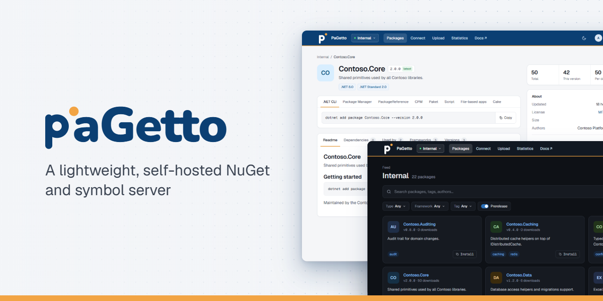

A lightweight package server written in C#: self-hosted, cross-platform and cloud ready. One server hosts the packages of 15 ecosystems, from [NuGet] (with a [symbol] server) and npm to Maven, Python, Rust and Go, each in its own feeds and with a read-through mirror of its public registry.

PaGetto started as a fork of [BaGetter], a NuGet server. It has a redesigned web UI, a reworked code base and new features such as more package formats, multiple feeds, user and permission management, and Microsoft Entra ID sign-in. Coming from BaGetter? The [migration guide][Migration] shows how to move an existing installation over.

[![CI][CI badge]][CI link] [![Release][Release badge]][Release link] [![Docker][Docker badge]][Docker link] [![Docs][Docs badge]][Documentation]

## 🧩 Package formats

Each feed hosts one package format and speaks its protocol, so the standard clients work with nothing more than the feed's URL and a token.

| Languages | Package format | Clients | Mirror of |
|---|---|---|---|
| C#, F#, Visual Basic (.NET) | [NuGet][Docs NuGet], with symbols (`.snupkg`) | dotnet CLI, NuGet CLI, Visual Studio, Rider, Paket | nuget.org, any NuGet v3 or v2 feed |
| JavaScript, TypeScript | [npm][Docs npm] | npm, Yarn, pnpm | registry.npmjs.org |
| Java, Kotlin, Scala, Groovy | [Maven][Docs Maven] | Maven, Gradle, sbt | Maven Central |
| Python | [PyPI][Docs PyPI] (simple API) | pip, uv, Poetry, twine | PyPI |
| Rust | [Cargo][Docs Cargo] (sparse registry) | Cargo | crates.io |
| Go | [Go modules][Docs Go] (GOPROXY) | go command | proxy.golang.org |
| Ruby | [RubyGems][Docs RubyGems] (compact index) | Bundler, gem | rubygems.org |
| PHP | [Composer][Docs Composer] | Composer | Packagist |
| Dart, Flutter | [pub][Docs Dart] | `dart pub`, `flutter pub` | pub.dev |
| Elixir, Erlang | [Hex][Docs Hex] | Mix, Rebar3 | hex.pm |
| Swift, Objective-C | [CocoaPods][Docs CocoaPods] (CDN spec repository) | CocoaPods | cdn.cocoapods.org |
| Swift | [Swift package registry][Docs Swift] | Swift Package Manager, Xcode | other Swift package registries |
| R | [CRAN][Docs CRAN] (source packages) | `install.packages`, renv | CRAN |
| Scala (sbt) | [Ivy][Docs Ivy] (sbt's Ivy layout) | sbt | the sbt plugin repository |
| Visual Studio extensions | [VSIX][Docs VSIX] (private extension gallery) | Visual Studio | other extension galleries |

## 📦 Features

* **Multiple feeds**: each feed serves one package format under `/feeds/{slug}/`, with its own packages, settings, retention, permissions, webhook and read-through mirrors.
* **Read-through mirrors**: [mirror the public registries][Read through caching], several upstreams per feed in order, so builds keep working when an upstream is down.
* **Users & permissions**: `Local`, `Entra` or `Hybrid` authentication, groups, per-feed pull/push/delete permissions, and personal access tokens (also limited to reading or to one feed) with expiry email reminders.
* **Web UI** to browse every feed, with readmes and install commands per client, and admin pages for feeds, accounts and groups.
* **Operations**: retention per feed, webhooks, an audit log, health checks and OpenTelemetry metrics.
* **Pluggable backends**: SQLite, SQL Server, PostgreSQL or MySQL; the file system, Azure Blob, AWS S3, Google Cloud Storage, Aliyun OSS or Tencent COS.
* **Runs anywhere**: Windows, Linux and macOS, x64 and ARM64, Docker, Kubernetes (Helm) or IIS.

## 🚀 Getting started

**Docker**

```bash
docker run -d -p 5000:8080 -v pagetto-data:/data letreset/pagetto:latest
```

Then browse to `http://localhost:5000/` and sign in as `admin` with the password `admin`; PaGetto asks for a new password first. Create a feed for each package format you use under **Admin > Feeds**, and a token under **My Tokens** for your clients.

**Kubernetes**

```bash
helm install pagetto oci://ghcr.io/letreset/charts/pagetto --version <version>
```

**.NET / IIS**

1. Install the [ASP.NET Core 10 runtime] (for IIS, the [hosting bundle]).
2. Download and extract `pagetto-<version>.zip` from the [latest release][Release link].
3. Run `dotnet PaGetto.dll`, or point an IIS site at the extracted folder.

See the [documentation] for connecting each client, configuration, authentication and cloud deployments.

## 🛠️ Development

```bash
dotnet build
dotnet test
dotnet run --project src/PaGetto
```

Releases are cut by pushing a `vX.Y.Z` tag on `main`. Each release publishes the zip, the Docker image and the Helm chart, with a generated changelog. The roadmap is tracked in [GitHub issues][Issues].

## 📄 License

[MIT](LICENSE).

[NuGet]: https://learn.microsoft.com/nuget/what-is-nuget
[symbol]: https://learn.microsoft.com/windows/win32/debug/symbol-servers-and-symbol-stores
[BaGetter]: https://github.com/bagetter/BaGetter
[ASP.NET Core 10 runtime]: https://dotnet.microsoft.com/download/dotnet/10.0
[hosting bundle]: https://dotnet.microsoft.com/permalink/dotnetcore-current-windows-runtime-bundle-installer
[Documentation]: https://letreset.github.io/PaGetto/
[Migration]: https://letreset.github.io/PaGetto/docs/migrating-from-bagetter
[Read through caching]: https://letreset.github.io/PaGetto/docs/feeds#mirror-read-through-cache
[Issues]: https://github.com/letreset/PaGetto/issues
[Docs NuGet]: https://letreset.github.io/PaGetto/docs/nuget
[Docs npm]: https://letreset.github.io/PaGetto/docs/npm
[Docs Maven]: https://letreset.github.io/PaGetto/docs/maven
[Docs PyPI]: https://letreset.github.io/PaGetto/docs/pypi
[Docs Cargo]: https://letreset.github.io/PaGetto/docs/cargo
[Docs Go]: https://letreset.github.io/PaGetto/docs/go
[Docs RubyGems]: https://letreset.github.io/PaGetto/docs/rubygems
[Docs Composer]: https://letreset.github.io/PaGetto/docs/composer
[Docs Dart]: https://letreset.github.io/PaGetto/docs/dart
[Docs Hex]: https://letreset.github.io/PaGetto/docs/hex
[Docs CocoaPods]: https://letreset.github.io/PaGetto/docs/cocoapods
[Docs Swift]: https://letreset.github.io/PaGetto/docs/swift
[Docs CRAN]: https://letreset.github.io/PaGetto/docs/cran
[Docs Ivy]: https://letreset.github.io/PaGetto/docs/ivy
[Docs VSIX]: https://letreset.github.io/PaGetto/docs/vsix

[CI badge]: https://img.shields.io/github/actions/workflow/status/letreset/PaGetto/ci.yml?branch=main&logo=github&label=CI
[CI link]: https://github.com/letreset/PaGetto/actions/workflows/ci.yml
[Release badge]: https://img.shields.io/github/v/release/letreset/PaGetto?logo=github&sort=semver
[Release link]: https://github.com/letreset/PaGetto/releases
[Docker badge]: https://img.shields.io/docker/v/letreset/pagetto?logo=docker&logoColor=fff&label=docker&sort=semver
[Docker link]: https://hub.docker.com/r/letreset/pagetto
[Docs badge]: https://img.shields.io/badge/docs-GitHub%20Pages-blue
